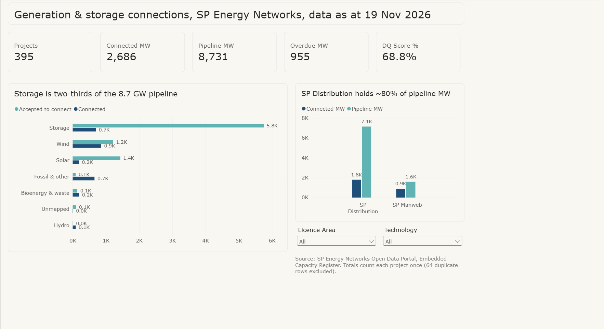
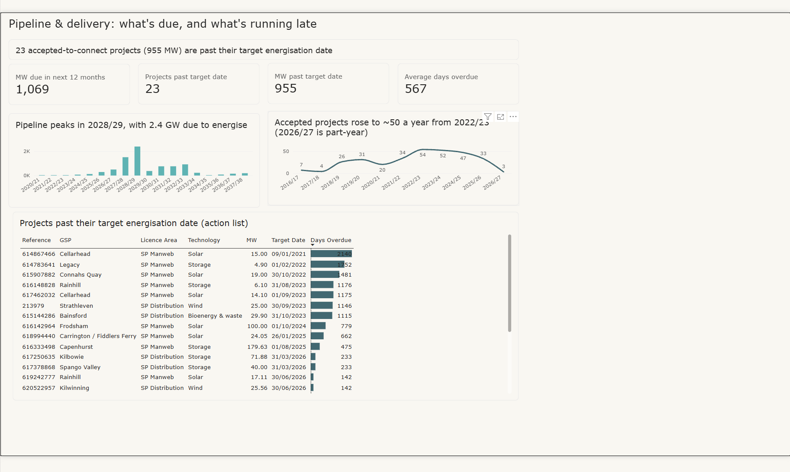
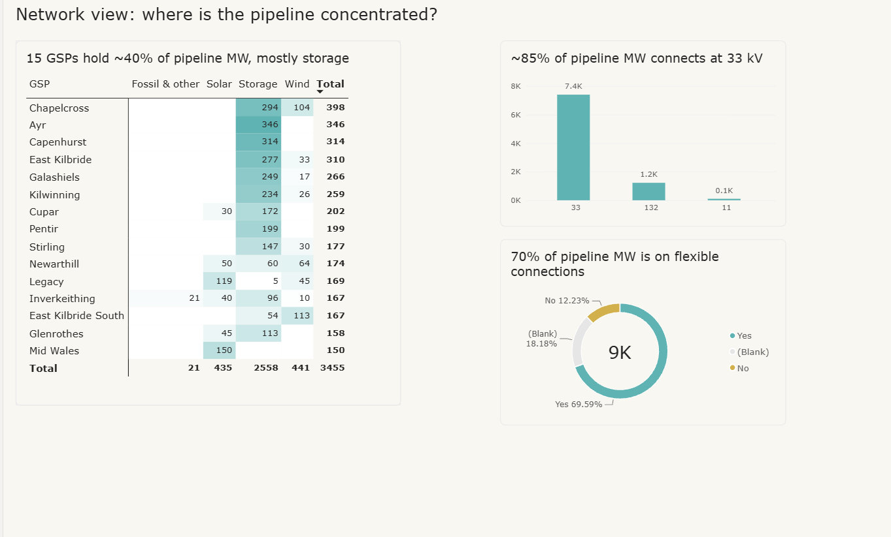
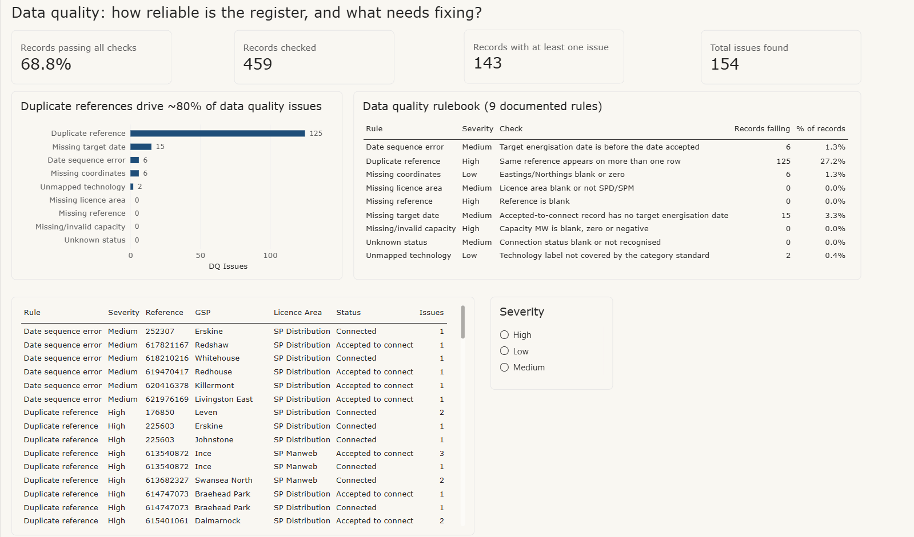
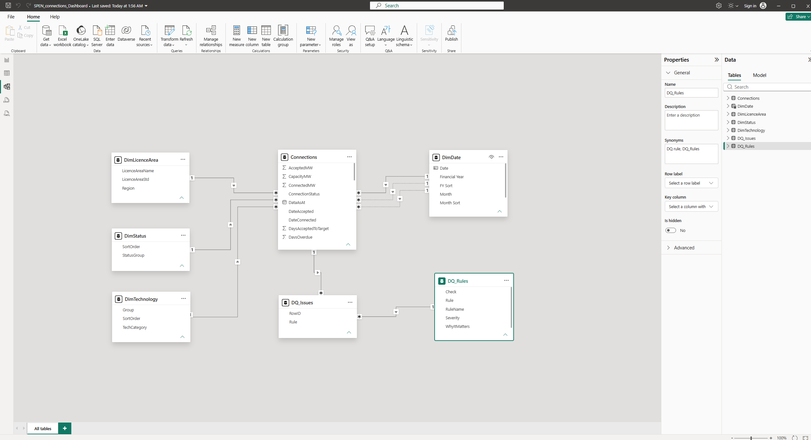

# SP Energy Networks: Network Capacity & Connections Dashboard (Power BI)

A 4-page Power BI report built on SP Energy Networks' open **Embedded Capacity Register**. It tracks connected and pipeline generation and storage across the **SP Distribution (SPD)** and **SP Manweb (SPM)** licence areas, flags projects past their target energisation date, and scores every record against **9 documented data quality rules**.

## Business questions
1. How much generation and storage is connected vs in the connection pipeline, by licence area and technology?
2. Which accepted-to-connect projects are past their target energisation date, and how much MW is affected?
3. How much pipeline MW is due in the next 12 months, and when does the pipeline peak?
4. Where on the network (Grid Supply Point, voltage) is the pipeline concentrated?
5. How reliable is the data, and which records need to go back to the data owner?

## Key findings (data as at 19 Nov 2026)
- **395 projects** (from 459 source rows): **2,686 MW connected** and **8,731 MW accepted to connect**. The pipeline is about 3.3× what's already connected.
- **Storage is two-thirds of pipeline MW** (~5.8 GW). **SP Distribution holds ~80%** of the pipeline.
- **23 accepted-to-connect projects (955 MW, ~11% of pipeline MW) are past their target energisation date.** On average they are 567 days overdue, and the oldest is over 2,100 days.
- **1,069 MW** is due to energise in the next 12 months. The pipeline **peaks in 2028/29 (2.4 GW)**.
- Accepted projects rose to **~50 a year from 2022/23**.
- **15 Grid Supply Points hold ~40% of pipeline MW**, **~85%** connects at **33 kV**, and **~70%** of pipeline MW is on **flexible connections**. A further 18% has no connection type recorded.
- **68.8% of records pass all 9 data quality rules.** **Duplicate references drive ~80% of issues** (125 of 154). Some duplicates conflict with each other, e.g. the same reference recorded as both *connected* and *accepted to connect*, or under two different GSPs.

## What I did
- **Power Query (M):** a keyword-based column mapper, so the load survives header changes; cleansing; UK date and number typing; SPEN placeholder values ("data not available", "data not applicable") standardised to blank; technology labels mapped to a single category standard.
- **Deduplication:** 64 duplicate rows across 61 references. Totals count each project once (keeping the latest target date), while every duplicate stays flagged for the data owner.
- **Data quality and governance:** 9 documented rules with severity, a record-level DQ score, and a "records to send back to the data owner" list ([rules and results](docs/data_quality_rules.md), [data dictionary](docs/data_dictionary.md)).
- **GDPR:** customer name and address fields are excluded at load (data minimisation).
- **Data model:** a star schema (Connections fact table with Date, Licence Area, Technology and Status dimensions), a UK financial-year calendar (Apr–Mar), and inactive relationships switched on with `USERELATIONSHIP` to report by accepted and connected date.
- **DAX:** KPI, exception and data quality measures ([measures](dax/03_Measures.dax)).

## Report pages
| Page | What it answers |
|---|---|
| **Overview** | Connected vs pipeline MW by technology and licence area; headline KPIs |
| **Pipeline & delivery** | MW due by financial year, applications accepted per year, and an action list of the 23 overdue projects |
| **Network view** | Top 15 GSPs heat map, pipeline by voltage, flexible vs firm connections |
| **Data quality** | DQ score, issues by rule, the rulebook, and records to send back to the data owner |
| **About** | Source, definitions, method, data protection |

| Pipeline & delivery | Network view | Data quality |
|---|---|---|
|  |  |  |

## Reproduce it
1. Register on the [SP Energy Networks Open Data Portal](https://spenergynetworks.opendatasoft.com) and export the *Embedded Capacity Register* as CSV.
2. In Power BI Desktop, create the `FilePath` and `DataAsAt` parameters, then add the queries in `powerquery/` in number order (see `powerquery/00_README.md`).
3. Build the model and measures from `dax/`.

## Data and licence
Data © SP Energy Networks, used under its Shared Data Licence terms. Raw data isn't redistributed in this repo.

## Tools
Power BI Desktop · Power Query (M) · DAX

*Author: Tanmay Bhagat · [linkedin.com/in/bhagattanmay](https://linkedin.com/in/bhagattanmay)*
